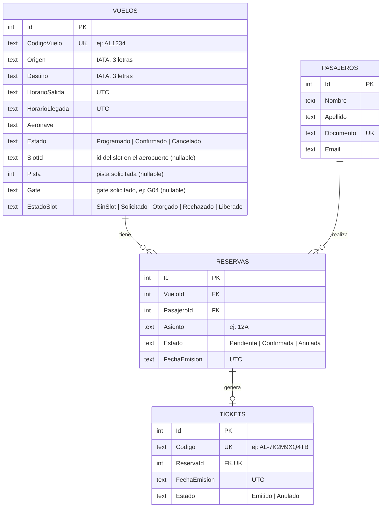

# Modelo de base de datos — AeroLink

Base: **SQLite** (Entity Framework Core, enfoque *code-first*). Las clases de `Models/` son la fuente de verdad;
`Data/AeroLinkDbContext.cs` define claves, índices y relaciones. El script SQL de abajo es el equivalente
de referencia (EF lo genera con `dotnet ef migrations script`).

## Diagrama entidad-relación



## Reglas que garantiza la base

| Regla | Mecanismo |
|---|---|
| El código de vuelo es único | índice único `IX_Vuelos_CodigoVuelo` |
| El documento del pasajero es único | índice único `IX_Pasajeros_Documento` |
| Un asiento no se ocupa dos veces en un vuelo (las reservas anuladas liberan el asiento) | índice único **parcial** `(VueloId, Asiento) WHERE Estado <> 'Anulada'` |
| El código de ticket es único | índice único `IX_Tickets_Codigo` |
| Una reserva tiene como máximo un ticket | índice único `IX_Tickets_ReservaId` (relación 1 a 0..1) |
| No se borran vuelos/pasajeros con reservas | FK con `ON DELETE RESTRICT` (de todos modos la API no borra: cancela cambiando el estado) |

Las validaciones de negocio (estados válidos, vuelo confirmado solo con slot, etc.) viven en la capa de servicios; los
índices únicos son la última red de seguridad ante concurrencia.

## Script SQL (SQLite)

```sql
CREATE TABLE "Vuelos" (
    "Id"            INTEGER NOT NULL CONSTRAINT "PK_Vuelos" PRIMARY KEY AUTOINCREMENT,
    "CodigoVuelo"   TEXT    NOT NULL,          -- máx. 10
    "Origen"        TEXT    NOT NULL,          -- máx. 3
    "Destino"       TEXT    NOT NULL,          -- máx. 3
    "HorarioSalida"   TEXT  NOT NULL,          -- ISO-8601 UTC
    "HorarioLlegada"  TEXT  NOT NULL,
    "Aeronave"      TEXT    NOT NULL,          -- máx. 20
    "Estado"        TEXT    NOT NULL,          -- Programado | Confirmado | Cancelado
    "SlotId"        TEXT    NULL,              -- máx. 60
    "Pista"         INTEGER NULL,              -- pista pedida al aeropuerto
    "Gate"          TEXT    NULL,              -- máx. 10 (ej: G04)
    "EstadoSlot"    TEXT    NOT NULL           -- SinSlot | Solicitado | Otorgado | Rechazado | Liberado
);
CREATE UNIQUE INDEX "IX_Vuelos_CodigoVuelo" ON "Vuelos" ("CodigoVuelo");
CREATE INDEX        "IX_Vuelos_SlotId"      ON "Vuelos" ("SlotId");

CREATE TABLE "Pasajeros" (
    "Id"        INTEGER NOT NULL CONSTRAINT "PK_Pasajeros" PRIMARY KEY AUTOINCREMENT,
    "Nombre"    TEXT NOT NULL,                 -- máx. 60
    "Apellido"  TEXT NOT NULL,                 -- máx. 60
    "Documento" TEXT NOT NULL,                 -- máx. 15
    "Email"     TEXT NOT NULL                  -- máx. 120
);
CREATE UNIQUE INDEX "IX_Pasajeros_Documento" ON "Pasajeros" ("Documento");

CREATE TABLE "Reservas" (
    "Id"           INTEGER NOT NULL CONSTRAINT "PK_Reservas" PRIMARY KEY AUTOINCREMENT,
    "PasajeroId"   INTEGER NOT NULL,
    "VueloId"      INTEGER NOT NULL,
    "Asiento"      TEXT    NOT NULL,           -- máx. 3
    "Estado"       TEXT    NOT NULL,           -- Pendiente | Confirmada | Anulada
    "FechaEmision" TEXT    NOT NULL,
    CONSTRAINT "FK_Reservas_Pasajeros_PasajeroId" FOREIGN KEY ("PasajeroId") REFERENCES "Pasajeros" ("Id") ON DELETE RESTRICT,
    CONSTRAINT "FK_Reservas_Vuelos_VueloId"       FOREIGN KEY ("VueloId")    REFERENCES "Vuelos" ("Id")    ON DELETE RESTRICT
);
CREATE INDEX        "IX_Reservas_PasajeroId"        ON "Reservas" ("PasajeroId");
CREATE UNIQUE INDEX "IX_Reservas_VueloId_Asiento"   ON "Reservas" ("VueloId", "Asiento") WHERE "Estado" <> 'Anulada';

CREATE TABLE "Tickets" (
    "Id"           INTEGER NOT NULL CONSTRAINT "PK_Tickets" PRIMARY KEY AUTOINCREMENT,
    "Codigo"       TEXT    NOT NULL,           -- máx. 20
    "ReservaId"    INTEGER NOT NULL,
    "FechaEmision" TEXT    NOT NULL,
    "Estado"       TEXT    NOT NULL,           -- Emitido | Anulado
    CONSTRAINT "FK_Tickets_Reservas_ReservaId" FOREIGN KEY ("ReservaId") REFERENCES "Reservas" ("Id") ON DELETE RESTRICT
);
CREATE UNIQUE INDEX "IX_Tickets_Codigo"    ON "Tickets" ("Codigo");
CREATE UNIQUE INDEX "IX_Tickets_ReservaId" ON "Tickets" ("ReservaId");
```

## Ciclos de estado

```
Vuelo     Programado ──(slot otorgado: callback o /confirmar)──▶ Confirmado
              │                                                     │
              └──────────────(/cancelar)────────────────────────────┴──▶ Cancelado   (anula reservas y tickets, libera slot)

Slot      SinSlot ─▶ Solicitado ─▶ Otorgado ─▶ Liberado (al cancelar)
                         └──────▶ Rechazado ─▶ (se puede volver a solicitar)

Reserva   Pendiente ─(/confirmar)─▶ Confirmada ─▶ Anulada (cancelación de reserva o de vuelo)
Ticket    Emitido ─▶ Anulado (al anularse su reserva o el vuelo)
```
